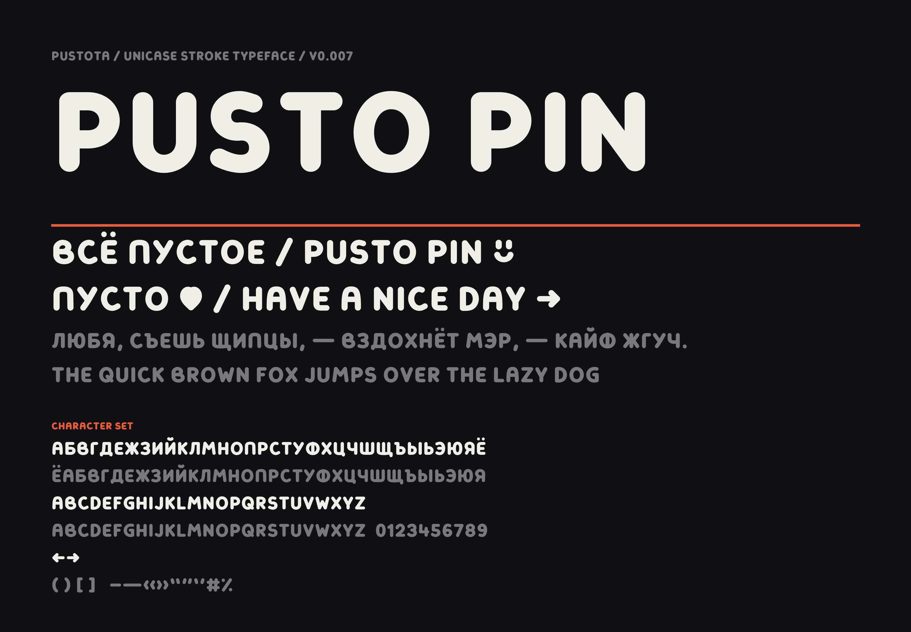

# Pusto Pin

A rounded unicase stroke typeface by [Pustota](https://pustota.name), with Latin and Cyrillic support.
Born for the Pusto pins, it comes with a few emoticon ligatures built in.



[](LICENSE)

> Early work in progress (v0.007): spacing and kerning are not done yet.

---

## Download

Use the files from [`fonts/`](fonts):

| Format | File | Use for |
| --- | --- | --- |
| OTF | [`PustoPin-Regular.otf`](fonts/PustoPin-Regular.otf) | Desktop apps, print |
| WOFF2 | [`PustoPin-Regular.woff2`](fonts/PustoPin-Regular.woff2) | Web (modern browsers) |
| WOFF | [`PustoPin-Regular.woff`](fonts/PustoPin-Regular.woff) | Web (fallback) |

## Install

**macOS**: double-click `PustoPin-Regular.otf` and press *Install Font*.
**Windows**: right-click the `.otf` and choose *Install*.
**Linux**: copy the `.otf` into `~/.local/share/fonts/` and run `fc-cache -f`.

## Use on the web

```css
@font-face {
  font-family: "Pusto Pin";
  src: url("fonts/PustoPin-Regular.woff2") format("woff2"),
       url("fonts/PustoPin-Regular.woff")  format("woff");
  font-weight: 400;
  font-style: normal;
  font-display: swap;
}

h1 {
  font-family: "Pusto Pin", sans-serif;
}
```

## Ligatures

With standard ligatures on (the default in browsers and most apps):

| Type | Get |
| --- | --- |
| `:)` `:-)` | smile |
| `:(` `:-(` | frown |
| `;)` `;-)` | wink |
| `<3` | heart |
| `->` `<-` | arrows |

## Source

The typeface is designed in [Glyphs](https://glyphsapp.com). The editable source lives in
[`sources/`](sources); the `fonts/` files are exported from it.

## Building a release

```bash
# 1. In Glyphs: export OTF + WOFF + WOFF2 and save the .glyphs source into the repo root
# 2. From the repo root:
./release.sh
```

`release.sh` moves the exported files into place, renames them to stable names, reads the
version from the source name, commits, tags `vX.Y.Z` and, after confirmation, publishes a
GitHub Release with a zipped font package.

To refresh the specimen image:

```bash
pip install uharfbuzz freetype-py fonttools Pillow
python3 tools/render_specimen.py
```

## License

This font is licensed under the **SIL Open Font License, Version 1.1**.
You may use, study, modify and redistribute it freely, including in commercial work;
you just may not sell the font by itself. See [`LICENSE`](LICENSE) and [`FONTLOG.txt`](FONTLOG.txt).

*Copyright © 2026 Pustota, with Reserved Font Name “Pusto Pin”.*
